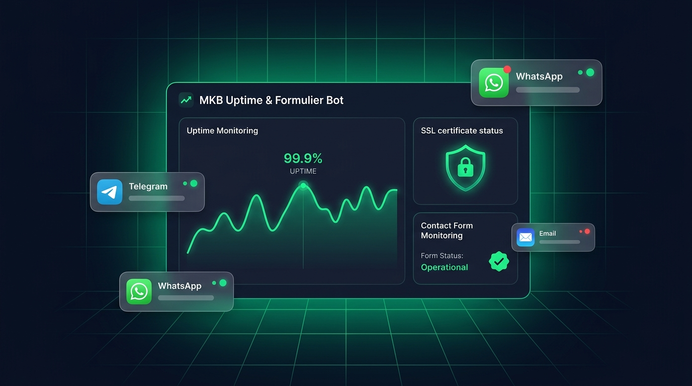

# MKB Uptime & Formulier Bot (`mkb-uptime-bot`)



> **Live Demo & Dashboard:** [https://philip-wintrip.nl/mkb-uptime-bot/](https://philip-wintrip.nl/mkb-uptime-bot/)

Een lichtgewicht, zelf-hostbare **Monitoring & Uptime SaaS-dienst** speciaal ontworpen voor lokale MKB-websites (micro-abonnementen van **€ 3 tot € 7 per domein per maand**).

Kleine ondernemers merken vaak pas dagen of weken later dat hun contactformulier kapot is na een plugin-update, hun SSL-certificaat is verlopen of hun website een lege witte pagina toont. **MKB Uptime & Formulier Bot** controleert niet alleen of de server pingt, maar bewaakt ook de daadwerkelijke inhoud en formulieren op de pagina.

---

## ✨ Belangrijkste Functionaliteiten

| Onderdeel | Frequentie | Wat wordt er gecontroleerd? |
| :--- | :--- | :--- |
| **HTTP & Laadtijd Check** | Elke minuut (`60s`) | HTTP-statuscode (`200 OK`), exacte responstijd in ms en drempelbewaking (bijv. `< 2500 ms`). |
| **Kernwoorden (Keyword) Check** | Elke minuut (`60s`) | Controleert of verplichte woorden (zoals *"Openingstijden"*, *"Bestellen"*, *"KvK"*) daadwerkelijk op de pagina staan. Vangt direct een "White Screen of Death" of defacement af. |
| **DOM Formulier-inspectie** | Elke minuut (`60s`) | Analyseert de HTML met BeautifulSoup: bestaat `<form>`, zijn er zichtbare invoervelden (`input`/`textarea`/`select`) en een actieve verzendknop (`button[type=submit]`)? |
| **Playwright Browser-check** | Elke 15 minuten | Opent de pagina in een echte headless Chromium-browser, vangt fatale JavaScript-fouten (`pageerror`) af, controleert of het formulier zichtbaar en invulbaar is, zonder spam te versturen. |
| **SSL/TLS Certificaat Check** | Elke 15 minuten | Inspecteert het X.509-certificaat op poort `443` en waarschuwt tijdig (standaard 14 dagen vóór verloopdatum). |
| **Anti-Flapping State Machine** | Continu | Voorkomt valse nachtelijke alarmen door een directe retry uit te voeren en pas bij een instelbare drempel (standaard 2 opeenvolgende fouten) een incident te openen. |
| **Multi-Channel Alerts** | Direct bij incident & herstel | Stuurt directe storings- én herstelmeldingen (`🔴 STORING` / `🟢 WEER ONLINE`) via **Telegram**, **E-mail (Resend / SMTP)** en **WhatsApp (Twilio / Cloud Webhook)**. |

---

## 🏗️ Architectuur

```mermaid
flowchart TD
    subgraph Scheduler["Achtergrond Worker (APScheduler + asyncio)"]
        CronFast["1-Minuut Loop (httpx + BeautifulSoup)"]
        CronDeep["15-Minuten Loop (SSL + Playwright Headless Browser)"]
    end

    subgraph Engine["Evaluatie & Anti-Flapping Engine"]
        CheckHTTP["HTTP Status & Laadtijd"]
        CheckKW["Kernwoorden & DOM <form> Check"]
        CheckSSL["TLS/SSL Verloopdatum Check"]
        CheckPW["Playwright Formulier-interactie"]
        State["Incident State Machine (UP / DEGRADED / DOWN)"]
    end

    subgraph Storage["Opslag"]
        DB[("SQLite (WAL-modus)")]
    end

    subgraph Alerts["Notificatie Kanalen"]
        TG["Telegram Bot API"]
        EM["E-mail (Resend / SMTP)"]
        WA["WhatsApp (Twilio / Webhook)"]
    end

    CronFast --> CheckHTTP & CheckKW
    CronDeep --> CheckSSL & CheckPW
    CheckHTTP & CheckKW & CheckSSL & CheckPW --> State
    State <--> DB
    State -->|Storing of Herstel| TG & EM & WA
```



---

## 💼 Abonnementsmodel (MKB Micro-SaaS)

Het dashboard berekent automatisch de **MRR (Maandelijkse Omzet)** op basis van drie pakketten:
- **Basis (€ 3 / domein / mnd):** Elke minuut HTTP-, laadtijd-, SSL- & kernwoordencheck + meldingen via E-mail en Telegram.
- **Pro Formulier (€ 5 / domein / mnd):** Inclusief DOM- én periodieke Playwright headless contactformulier-check.
- **Compleet (€ 7 / domein / mnd):** Inclusief directe **WhatsApp**-meldingen en uitgebreide incidenthistorie.

---

## 🚀 Snelstart (Lokaal & Productie)

### 1. Installatie

```bash
git clone https://github.com/pwintri2/mkb-uptime-bot.git
cd mkb-uptime-bot

python3 -m venv .venv
source .venv/bin/activate
pip install -e ".[dev]"

# Optioneel: installeer Chromium voor de diepe Playwright formulier-checks
playwright install chromium
```

### 2. Configuratie (`.env`)

Kopieer `.env.example` naar `.env` en vul je gewenste notificatiekanalen in:

```bash
cp .env.example .env
```

### 3. Tests uitvoeren

```bash
pytest -v
```

### 4. Server & Achtergrond-worker starten

```bash
uvicorn app.main:app --reload --port 8000
```

- **Dashboard:** `http://localhost:8000`
- **Ingebouwde MKB-testpagina (gezond):** `http://localhost:8000/demo/mkb-contact`
- **Simulatie kapot contactformulier:** `http://localhost:8000/demo/mkb-contact?broken_form=true`
- **Simulatie ontbrekend kernwoord:** `http://localhost:8000/demo/mkb-contact?missing_keyword=true`

---

## 📁 Projectstructuur

```text
mkb-uptime-bot/
├── app/
│   ├── main.py                 # FastAPI entrypoint, lifespan scheduler & demo-endpoint
│   ├── config.py               # Pydantic Settings (.env configuratie)
│   ├── database.py             # Async SQLAlchemy + SQLite WAL-modus
│   ├── models.py               # Subscriber, Monitor, CheckResult, Incident, NotificationChannel
│   ├── schemas.py              # Pydantic modellen
│   ├── checks/
│   │   ├── http_content.py     # 1-minuut HTTP, laadtijd, kernwoorden & DOM <form> check
│   │   ├── ssl_checker.py      # Asynchrone TLS/SSL verloopdatum inspectie
│   │   └── browser_form.py     # Playwright headless formulier-responsiviteit check
│   ├── services/
│   │   ├── incident_engine.py  # Anti-flapping state machine & incident-registratie
│   │   ├── notifier.py         # Telegram, E-mail (Resend/SMTP) & WhatsApp dispatcher
│   │   └── scheduler.py        # APScheduler 1-minuut, 15-minuten & retentie jobs
│   └── web/
│       ├── routes.py           # Dashboard routes, HTMX partials & JSON samenvatting
│       └── templates/          # Jinja2 + HTMX + Tailwind CSS templates
├── assets/
│   └── hero-banner.png         # Overzichtsillustratie
├── tests/                      # Volledige pytest + pytest-asyncio testsuite
├── app.php                     # Lichtgewicht PHP reverse-proxy brug
├── mkb-uptime-bot.service      # Systemd user-unit voor VPS deployment
└── pyproject.toml
```

---

## 🌐 Live Deployment

Deze applicatie draait live op **[https://philip-wintrip.nl/mkb-uptime-bot/](https://philip-wintrip.nl/mkb-uptime-bot/)**.
